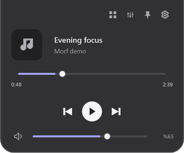
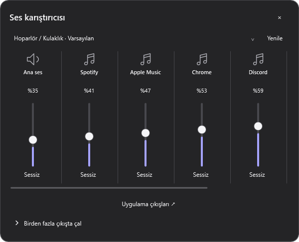
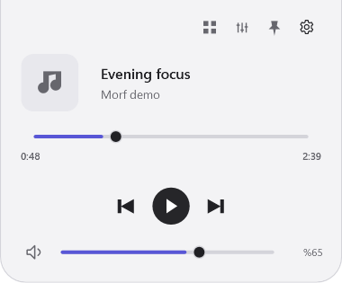
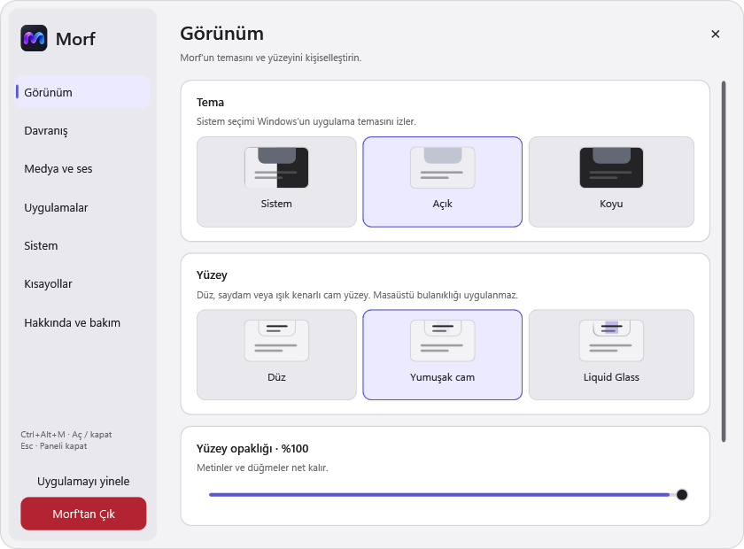

<p align="center">
  
</p>

<h1 align="center">Morf</h1>

<p align="center">Media controls, application audio and a temporary file shelf for Windows.</p>

<p align="center">
  <a href="README.tr.md">Türkçe</a> ·
  <a href="#getting-started">Getting started</a> ·
  <a href="docs/BUILDING.md">Build from source</a> ·
  <a href="docs/PLAN.md">Roadmap</a> ·
  <a href="LICENSE">MIT license</a>
</p>

Morf keeps everyday media and file actions in a small panel at the edge of your screen. Open it with your pointer or **Ctrl + Alt + M**, control the current media session, adjust application audio, or carry files between windows.

**Status:** `0.3.3-preview`. The first public binary release is being prepared. Signing, antivirus review and the remaining device checks are tracked in [release readiness](docs/RELEASING.md).

## A look at Morf

<table>
  <tr>
    <td align="center"></td>
    <td align="center"></td>
  </tr>
  <tr>
    <td align="center">Media player</td>
    <td align="center">Application audio</td>
  </tr>
</table>

<details>
  <summary>Light mode and settings</summary>
  <p></p>
  <p></p>
</details>

Screenshots are rendered from the current Windows interface with demonstration media and audio sessions. The interface is currently in Turkish.

## Features

- **Media controls:** source selection, play/pause, previous/next, timeline seeking and supported shuffle/repeat controls. Playback stays in the original application.
- **Application audio:** separate volume and mute controls for Windows audio sessions, with output selection and live change notifications. Per-application output routing opens Windows settings.
- **Temporary file shelf:** drag local files and folders onto Morf, reorder or group them, then drag copies to another window or copy them for pasting. Originals stay where they are.
- **Windows notifications:** optional previews with application preferences, content visibility, readable text, swipe dismissal and source-application opening. WhatsApp chats are selected inside WhatsApp. Live notifications require the MSIX build and Windows permission.
- **Compact views:** capsule, thin line, automatic hiding and a floating island. An idle clock appears in supported visible modes.
- **Time tools:** countdown and stopwatch controls below the player, with a compact indicator. The stopwatch restores its saved elapsed time paused after reopening; countdowns last for the current app session.
- **Appearance and behavior:** light/dark/system themes, surface transparency, pinning, monitor selection, application rules and reduced-motion support.
- **Media handoff:** optional pausing of other sources and guarded return to music that Morf previously paused.

Optional **multi-output audio** mirrors a selected output to additional connected devices. It is experimental: Bluetooth delay, device clocks and protected/exclusive streams can affect playback. Physical speaker-plus-Bluetooth validation is still pending.

## Getting started

### Requirements

- Windows desktop. The Windows API baseline is **Windows 10 1809 / build 17763**; Windows 11 is the primary development environment. This does not establish support for every Windows edition or release.
- **Portable preview:** .NET Framework 4.8 and 64-bit PowerShell for building.
- **SDK build:** .NET 10 SDK to build, and a Windows version supported by the corresponding .NET Desktop Runtime.
- **Live notifications:** a trusted, signed MSIX package and explicit Windows notification access.

### Build and run

From the repository root, using PowerShell on Windows:

```powershell
dotnet build src/Widgates/Widgates.csproj -c Release
dotnet run --project src/Widgates/Widgates.csproj -c Release --no-build
```

To build the portable preview with Windows' .NET Framework compiler:

```powershell
.\scripts\Build-InboxPreview.ps1
.\artifacts\inbox-preview\WindowsWidgates.exe
```

See [building and packaging](docs/BUILDING.md) for checks, current-user installation and notification-enabled MSIX packaging.

> Earlier preview binaries triggered Kaspersky detections. These have not been established as false positives. Local builds and passing checks do not resolve antivirus findings; do not disable protection to run Morf. See [release readiness](docs/RELEASING.md).

### Everyday controls

| Action | Control |
| --- | --- |
| Open or collapse the panel | `Ctrl + Alt + M` |
| Open settings | Gear icon or right-click the island |
| Keep the panel open | Pin icon |
| Open the audio mixer | Vertical sliders icon |
| Open countdown or stopwatch | Clock icon in the media application launcher menu |
| Skip a track | Previous/next buttons, or swipe the expanded track area |
| Collapse the panel | `Esc` |
| Exit | Settings or the tray menu; confirmation is required |

Additional media shortcuts can be configured in settings. Game and application hiding rules take priority over panel opening.

## Data and permissions

Morf runs as the current user. Preferences are stored under `%LOCALAPPDATA%\Morf`; the shelf and notification text are held in memory. The shelf contains up to **24 local paths** and is cleared on exit. Dropping a file does not move it. Clipboard contents change only when you request copying.

Stopwatch elapsed time is saved locally in `stopwatch.state`, including checkpoints while running. It restores paused; time while Morf is closed is not added. Reset clears the saved duration. Countdown state is held in memory.

The shelf rejects network paths, reparse points and some cloud placeholders. Missing or unsupported files are handled without executing them. Audio mirroring uses playback-output loopback in memory; it is not a microphone-recording feature and does not save audio files.

When notification previews are enabled, the packaged build can temporarily manage eligible Windows banner preferences and restore previous values on shutdown or when disabled. This integration depends on Windows settings behavior and has recovery limits. Read [privacy and Windows integration](docs/PRIVACY.md) before enabling it.

## Current limitations

- Media availability and supported commands depend on what the source application exposes to Windows. Browser tabs may share a session.
- The portable build cannot receive live Windows notifications. Notification previews do not provide quick replies or call controls.
- Transparent surfaces do not provide Apple-style background refraction or a guarantee of native blur.
- Multi-output synchronization, physical multi-monitor/DPI transitions and broader Windows compatibility need further device testing.
- Picture-in-picture is not included.

## Development

Morf uses **C#, WPF, Win32 and Windows media/Core Audio APIs**. No embedded web runtime is required.

```text
src/Widgates/            Application and embedded artwork
tests/Widgates.Checks/   Regression, layout and Windows integration checks
scripts/                Build, packaging and current-user installation tools
docs/                   Architecture, privacy, release guidance and screenshots
```

Start with [CONTRIBUTING.md](CONTRIBUTING.md) and [architecture](docs/ARCHITECTURE.md). Build output, local test reports and development archives belong in the ignored `artifacts/` directory.

## License

[MIT](LICENSE) · Copyright © 2026 Mustafa Günay.
