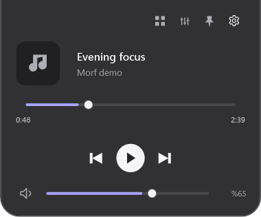
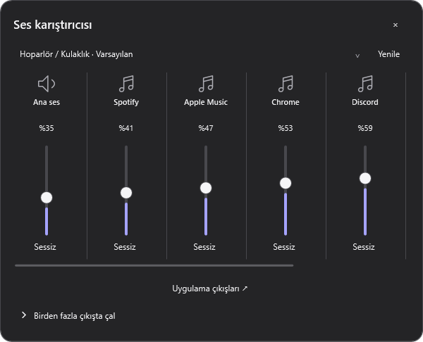
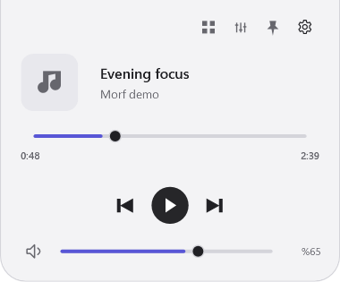
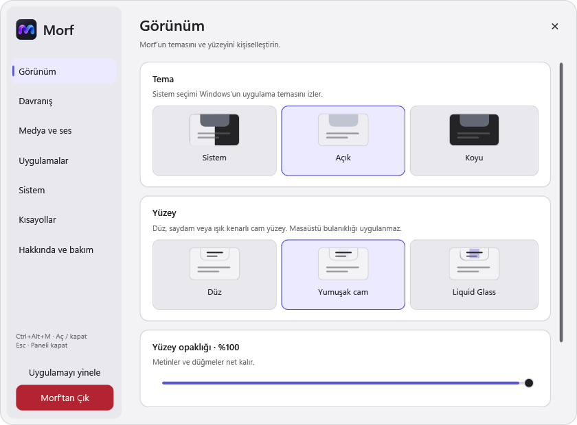

<p align="center">
  
</p>

<h1 align="center">Morf</h1>

<p align="center">Windows için medya denetimleri, uygulama sesleri ve geçici dosya rafı.</p>

<p align="center">
  <a href="README.md">English</a> ·
  <a href="#başlangıç">Başlangıç</a> ·
  <a href="docs/BUILDING.md">Derleme</a> ·
  <a href="docs/PLAN.md">Yol haritası</a> ·
  <a href="LICENSE">MIT lisansı</a>
</p>

Morf, günlük medya ve dosya işlemlerini ekran kenarındaki küçük bir panelde toplar. İşaretçinizle veya **Ctrl + Alt + M** ile açın; oynatmayı yönetin, uygulama seslerini ayarlayın veya dosyaları pencereler arasında taşıyacağınız rafa bırakın.

**Durum:** `0.3.3-preview`. İlk genel ikili dağıtım hazırlanıyor. İmzalama, antivirüs incelemesi ve kalan cihaz denemeleri [yayın hazırlığında](docs/RELEASING.md) listelenir.

## Görünüm

<table>
  <tr>
    <td align="center"></td>
    <td align="center"></td>
  </tr>
  <tr>
    <td align="center">Medya oynatıcı</td>
    <td align="center">Uygulama sesleri</td>
  </tr>
</table>

<details>
  <summary>Açık tema ve ayarlar</summary>
  <p></p>
  <p></p>
</details>

Görüntüler mevcut Windows arayüzünden örnek medya ve ses oturumlarıyla üretilmiştir. Uygulama arayüzü Türkçedir.

## Özellikler

- **Medya denetimleri:** kaynak seçimi, oynat/duraklat, önceki/sonraki, zaman çizelgesi ve kaynağın desteklediği karıştırma/tekrar seçenekleri. Oynatma kaynak uygulamada sürer.
- **Uygulama sesleri:** Windows ses oturumları için ayrı ses düzeyi ve sessize alma, çıkış seçimi ve anlık değişiklik takibi. Uygulamaya özel çıkış atamak için Windows ayarları açılır.
- **Geçici dosya rafı:** yerel dosya ve klasörleri bırakın, sıralayın veya gruplayın; ardından başka pencereye kopya olarak sürükleyin ya da yapıştırmak için kopyalayın. Asıllar yerinde kalır.
- **Windows bildirimleri:** uygulama tercihleri, içerik gizleme, okunabilir metin, kaydırarak kapatma ve kaynak uygulamayı açma. WhatsApp sohbeti uygulama içinden seçilir. Canlı bildirimler MSIX sürümü ve Windows izni gerektirir.
- **Kapalı görünümler:** kapsül, ince çizgi, otomatik gizleme ve dinamik ada. Uygun görünür modlarda boşta saat gösterilir.
- **Görünüm ve davranış:** açık/koyu/sistem teması, yüzey saydamlığı, sabitleme, ekran seçimi, uygulama kuralları ve azaltılmış hareket desteği.
- **Medya geçişi:** diğer kaynakları isteğe bağlı duraklatma ve Morf'un daha önce duraklattığı müziğe kontrollü dönüş.

İsteğe bağlı **çoklu ses çıkışı**, seçilen çıkışın sesini başka bağlı cihazlara da gönderir. Deneyseldir: Bluetooth gecikmesi, cihaz saatleri ve korumalı/özel akışlar oynatmayı etkileyebilir. Fiziksel hoparlör + Bluetooth denemesi henüz tamamlanmadı.

## Başlangıç

### Gereksinimler

- Windows masaüstü. API tabanı **Windows 10 1809 / derleme 17763**; ana geliştirme ortamı Windows 11'dir. Her Windows sürümü ve edisyonunda uyumluluk doğrulanmış değildir.
- **Taşınabilir önizleme:** .NET Framework 4.8; derleme için 64 bit PowerShell.
- **SDK sürümü:** derleme için .NET 10 SDK; çalıştırma için ilgili .NET Desktop Runtime'ın desteklediği bir Windows sürümü.
- **Canlı bildirimler:** güvenilir şekilde imzalanmış MSIX ve açık Windows bildirim erişimi.

### Derleme ve çalıştırma

Depo kökünde Windows PowerShell kullanın:

```powershell
dotnet build src/Widgates/Widgates.csproj -c Release
dotnet run --project src/Widgates/Widgates.csproj -c Release --no-build
```

Windows'un .NET Framework derleyicisiyle taşınabilir önizleme:

```powershell
.\scripts\Build-InboxPreview.ps1
.\artifacts\inbox-preview\WindowsWidgates.exe
```

Kontroller, mevcut kullanıcıya kurulum ve bildirimli MSIX için [derleme belgesine](docs/BUILDING.md) bakın.

> Önceki önizleme dosyaları Kaspersky tarafından işaretlendi. Bunların yanlış pozitif olduğu kesinleştirilmedi. Başarılı derleme ve kontroller antivirüs bulgusunu çözmez; Morf'u çalıştırmak için korumayı kapatmayın. Ayrıntılar [yayın hazırlığında](docs/RELEASING.md).

### Temel kullanım

| İşlem | Denetim |
| --- | --- |
| Paneli aç/kapat | `Ctrl + Alt + M` |
| Ayarları aç | Dişli simgesi veya adaya sağ tıklama |
| Paneli açık tut | Sabitleme simgesi |
| Ses karıştırıcısını aç | Dikey sürgü simgesi |
| Parça değiştir | Önceki/sonraki düğmeleri veya açık parça alanını kaydırma |
| Paneli kapat | `Esc` |
| Uygulamadan çık | Ayarlar veya bildirim alanı menüsü; onay gerekir |

Ek medya kısayolları ayarlardan tanımlanabilir. Oyun ve uygulama gizleme kuralları panel açılmasına göre önceliklidir.

## Veriler ve izinler

Morf mevcut kullanıcı yetkileriyle çalışır. Tercihler `%LOCALAPPDATA%\Morf` altında, raf ve bildirim metinleri bellekte tutulur. Raf en fazla **24 yerel yol** içerir ve çıkışta temizlenir. Dosya bırakmak aslını taşımaz. Pano yalnızca açık kopyalama işleminizle değişir.

Raf; ağ yollarını, reparse point içeren yolları ve bazı bulut yer tutucularını kabul etmez. Eksik veya desteklenmeyen dosyalar çalıştırılmaz. Ses çoğaltma, oynatma çıkışının sesini bellekte okur; mikrofon kaydı özelliği değildir ve ses dosyası oluşturmaz.

Bildirimler açıkken paketli sürüm uygun Windows başlık tercihlerini geçici yönetebilir; kapatıldığında veya normal çıkışta önceki değerleri geri alır. Windows davranışına bağlı bu bütünleştirmenin kurtarma sınırları vardır. Etkinleştirmeden önce [gizlilik ve Windows bütünleştirmesini](docs/PRIVACY.md) okuyun.

## Mevcut sınırlar

- Medya kaynağı ve kullanılabilir komutlar, uygulamanın Windows'a sunduklarına bağlıdır. Tarayıcı sekmeleri tek oturumda birleşebilir.
- Taşınabilir sürüm canlı Windows bildirimi alamaz. Hızlı yanıt ve çağrı denetimi yoktur.
- Saydam yüzeyler Apple benzeri arka plan kırılması veya yerel bulanıklık garantisi sunmaz.
- Çoklu ses çıkışı eşitlemesi, fiziksel çoklu ekran/DPI geçişleri ve daha geniş Windows uyumluluğu için cihaz denemeleri gerekir.
- Pencere içinde pencere özelliği dahil değildir.

## Geliştirme

Morf **C#, WPF, Win32 ve Windows medya/Core Audio API'lerini** kullanır. Gömülü web çalışma zamanı gerektirmez.

```text
src/Widgates/            Uygulama ve gömülü görseller
tests/Widgates.Checks/   Regresyon, yerleşim ve Windows bütünleştirme kontrolleri
scripts/                Derleme, paketleme ve mevcut kullanıcı kurulum araçları
docs/                   Mimari, gizlilik, yayın rehberi ve ekran görüntüleri
```

[Katkı rehberi](CONTRIBUTING.md) ve [mimari](docs/ARCHITECTURE.md) ile başlayın. Derleme çıktıları, yerel test raporları ve geliştirme arşivleri Git'in dışında tutulan `artifacts/` klasöründedir.

## Lisans

[MIT](LICENSE) · Copyright © 2026 Mustafa Günay.
